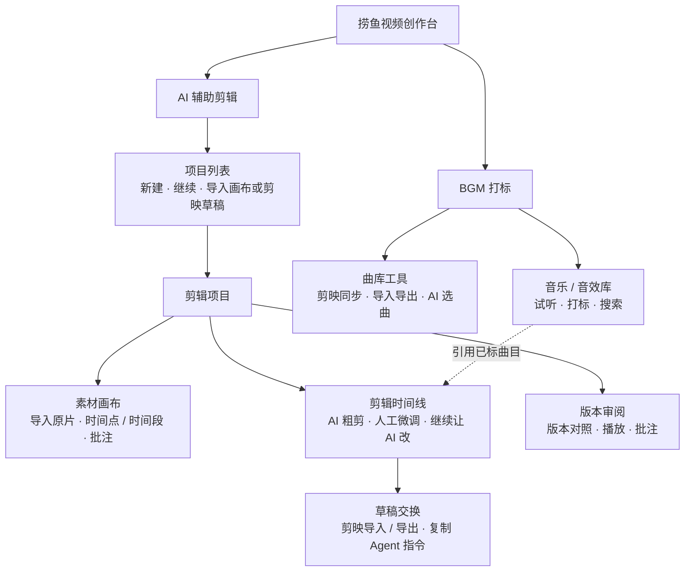

# 捞鱼视频创作台 · 页面关系评审

现状：V3 布局参考，本机开发版已接入  
负责人：捞鱼  
最后更新：2026-11-10

实线表示页面层级，虚线表示引用曲库。草稿交换是剪辑时间线的面板。

## 素材画布

中央无边界画布放原片卡和分镜卡，可缩放、平移、拖动卡片。选中原片后在同页打开播放和源时间轴，拖播放头看画面，拖选区间后放入关键内容点、分镜、口播或批注。已有标记可以拖动，右侧可以精确修改起止时间。卡片的空间位置与标注的源时间分别保存。

## 剪辑时间线

- 由画布标记生成剪辑单和可编辑的 AI 粗剪。时间线以画面、音频和字幕为基础轨，支持预览、分割、修剪两端、移动、排序、删除、调音量、改字幕文字与显示时间，以及撤销/重做。
- 用户从已采用版本开始微调，保存后可让 AI 按选中区间、标记或未解决批注继续改。锁定的片段、轨道或属性保留。没有指定范围时先显示拟修改范围。
- Agent 读带基线版本号的时间线和对应剪辑单，返回差异供选择采用。若 AI 运行中用户又动了同一处，显示冲突并保留两份修改。项目可引用已打标的曲库条目。
- 时间线工具栏打开[剪映草稿交换](剪映草稿.md)。已验证的剪映版本可一键输出副本并选回导入。未支持的环境可复制 Agent 指令并导出结构化时间线包。

## 版本审阅

对比 AI 粗剪、人工微调、导回剪映及后续 AI 候选。成片批注绑定版本和成片时间，源片批注保留在画布。回流导入生成新候选版本，采用前可查看新增、删除、移位和无法映射的内容。
